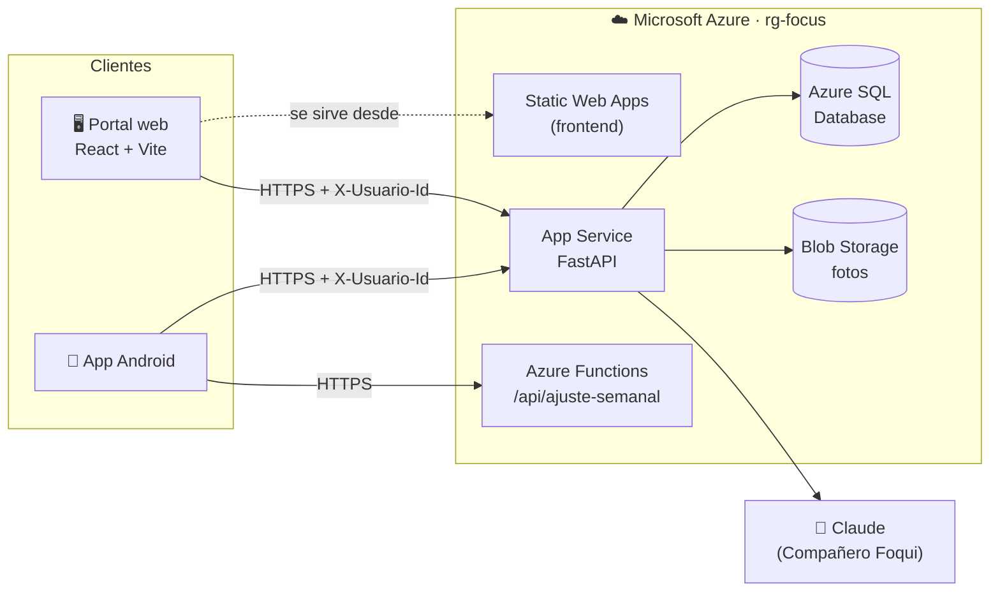

<p align="center">
  
</p>

<h3 align="center">Portal web y API en la nube para reducir gradualmente el tiempo en pantalla</h3>

<p align="center">
  Proyecto final de <b>Servicios Cloud</b> · Facultad de Informática, UAQ
</p>

<p align="center">
  
  
  
  
  
</p>

<p align="center">
  <a href="https://green-moss-07816e210.4.azurestaticapps.net"><b>🌐 Abrir el portal</b></a>
  &nbsp;·&nbsp;
  <a href="https://focus-api-luisbb27.azurewebsites.net/docs"><b>📘 API (Swagger)</b></a>
  &nbsp;·&nbsp;
  <a href="https://github.com/lbarrera27-pixel/focus_app"><b>📱 App Android</b></a>
  &nbsp;·&nbsp;
  <a href="#-desplegar-en-azure"><b>🚀 Desplegar</b></a>
</p>

---

## 📑 Contenido

- [En la nube](#-en-la-nube)
- [Requisitos de la entrega](#-requisitos-de-la-entrega)
- [Arquitectura](#-arquitectura)
- [Estructura del repositorio](#-estructura-del-repositorio)
- [Correr en local](#-correr-en-local)
- [Portal web](#-portal-web)
- [Desplegar en Azure](#-desplegar-en-azure)
- [API: identificación y rutas](#-api-identificación-y-rutas)
- [Reglas de negocio](#-reglas-de-negocio)
- [Bloqueo de apps](#-bloqueo-de-apps)
- [Inteligencia artificial: las 5 técnicas](#-inteligencia-artificial-las-5-técnicas)
- [Complemento: riesgo de recaída](#-complemento-riesgo-de-recaída)
- [Complemento: Compañero Foqui](#-complemento-compañero-foqui-llm)

---

## ☁️ En la nube

| | Parte | Servicio de Azure | URL |
|:-:|---|---|---|
| 🖥️ | **Frontend** · portal web (`web/`) | Azure Static Web Apps | [green-moss-07816e210.4.azurestaticapps.net](https://green-moss-07816e210.4.azurestaticapps.net) |
| ⚙️ | **Backend** · API FastAPI | Azure App Service + Azure SQL + Blob Storage | [focus-api-luisbb27.azurewebsites.net/docs](https://focus-api-luisbb27.azurewebsites.net/docs) |
| ⚡ | **Serverless** · ajuste semanal | Azure Functions | `POST focus-func-luisbb27.azurewebsites.net/api/ajuste-semanal` |
| 📱 | **App Android** (otro repo) | Usa esta misma API | [lbarrera27-pixel/focus_app](https://github.com/lbarrera27-pixel/focus_app) |

> [!TIP]
> La base de datos es *serverless* y se pausa tras una hora sin uso. Si el portal tarda en la primera
> carga, espera unos 30 segundos: la API responde `503` mientras despierta y el portal reintenta solo.

## ✅ Requisitos de la entrega

| Requisito | Cómo se cumple |
|---|---|
| CRUD de las APIs con controladores y rutas por tabla | 11 tablas, un controlador por tabla en `app/controllers/` (**68 operaciones**) |
| Base de datos en la nube | **Azure SQL Database** con SQLAlchemy (`create_all` sincroniza el esquema al arrancar) |
| Servicio de almacenamiento | **Azure Blob Storage**: `POST /usuarios/me/foto/archivo` sube la foto de perfil |
| 1 API desplegada en la nube (mínimo 12 rutas) | FastAPI en **Azure App Service** (Linux, Python 3.12) |
| 1 API con funciones serverless (una ruta) | **Azure Functions**: `POST /api/ajuste-semanal` (carpeta `serverless/`) |
| Frontend en la nube conectado a las API | Portal React (`web/`, diseño de Figma) en **Azure Static Web Apps**, llamando a la API de App Service |

## 🏗️ Arquitectura



El backend sigue las capas vistas en clase:

| Capa | Carpeta | Responsabilidad |
|---|---|---|
| **Controller** | `app/controllers/` | Recibe la petición HTTP, llama al servicio y regresa la respuesta |
| **Service** | `app/services/` | Reglas de negocio (numeración por usuario, integridad, cálculo del ajuste) |
| **Repository** | `app/repositories/` | Única capa que habla con la base de datos |
| **Model / Schema** | `app/models/`, `app/schemas/` | Tablas del ORM y validación de entrada/salida con Pydantic |

## 📂 Estructura del repositorio

```
focus_web/
│
├── README.md
├── .env.example, .gitignore
│
├── ─────────── BACKEND (API FastAPI → Azure App Service) ───────────
├── main.py                        ← crea la app, registra controladores y manejadores de error
├── requirements.txt
├── app/
│   ├── config.py                  variables de entorno (BD, Blob, CORS, LLM)
│   ├── database.py                engine, sesión y sincronización del esquema
│   ├── dependencies.py            usuario_actual(): lee el header X-Usuario-Id
│   ├── controllers/               rutas (un controlador por tabla, más riesgo y compañero)
│   ├── services/                  reglas de negocio
│   ├── repositories/              acceso a datos (única capa que usa SQLAlchemy)
│   ├── models/                    11 tablas del ORM (Azure SQL)
│   ├── schemas/                   validación de entrada / salida con Pydantic
│   ├── ia/                        las 5 técnicas de IA: modelo de pausas (ML), red neuronal,
│   │                              algoritmo genético, búsqueda A* y simulador de datos
│   └── utils/                     Blob Storage, reglas difusas, riesgo, LLM, bcrypt, errores
│
├── serverless/                    ← API serverless → Azure Functions (/api/ajuste-semanal)
├── ia/                            ← entrenamiento del modelo de riesgo (regresión logística desde cero)
│                                    y evaluación del Compañero Foqui
│
├── ─────────── FRONTEND (portal React + Vite → Azure Static Web Apps) ───────────
├── web/
│   ├── package.json, vite.config.js, index.html, .env.example
│   └── src/
│       ├── App.jsx, main.jsx
│       ├── api.js                 cliente de la API (header X-Usuario-Id)
│       ├── components/            Sidebar, TopBar, Card, Icono
│       ├── data/                  lógica de cada pantalla (panel, telemetría, análisis, clústeres, ajustes)
│       ├── pages/                 Login, Panel General, Telemetría, Análisis, Clústeres
│       │   └── ajustes/           Ajustes y sus 4 pestañas
│       └── assets/                íconos y logos del diseño de Figma
│
├── ─────────── DESPLIEGUE Y PRUEBAS ───────────
├── deploy/
│   ├── config.ps1                 nombres y región de los recursos
│   ├── 01_crear_recursos.ps1      SQL, Storage, App Service y Function App
│   ├── 02_desplegar_api.ps1       backend
│   ├── 03_desplegar_funcion.ps1   serverless
│   ├── 04_borrar_todo.ps1         elimina el grupo de recursos
│   ├── 05_desplegar_web.ps1       frontend
│   └── 06_datos_demo.py           cuenta con datos de ejemplo
├── docs/                          logo e insignias del README
├── postman/                       colección Focus_API_v2 con pruebas automáticas
└── tests/                         pytest: API, técnicas de IA, riesgo, compañero y reglas
```

## 💻 Correr en local

**Backend** (desde la raíz del repositorio):

```powershell
python -m venv .venv
.venv\Scripts\activate
pip install -r requirements.txt
uvicorn main:app --reload        # Swagger en http://127.0.0.1:8000/docs
```

Sin variables de entorno usa SQLite (`focus.db`). Para usar Azure SQL desde tu computadora, copia
`.env.example` a `.env` y llena los datos (necesitas el *ODBC Driver 18 for SQL Server*).

**Frontend:**

```powershell
cd web
copy .env.example .env           # VITE_API_URL apunta a la API (local o Azure)
npm install
npm run dev                      # http://localhost:5173
```

**Pruebas** (usan una base temporal, no tocan `focus.db` ni Azure):

```powershell
pip install pytest httpx
pytest -q
```

## 🖥️ Portal web

Panel de investigación hecho con **React + Vite** a partir del diseño de Figma (página *web*).
Inicia sesión con `/auth/login` y manda `X-Usuario-Id` en cada petición.

| Sección | Qué muestra | API que usa |
|---|---|---|
| **Panel General** | 6 tarjetas: uso por día, apps, pausas, plan, dispositivo y mapa de riesgo | `/estadisticas`, `/eventos`, `/apps`, `/pausas`, `/planes/activo` |
| **Telemetría Cloud** | Dispositivo, estado y latencia de la API, bitácora en vivo | `/salud`, `/tokens-dispositivo`, `/eventos` |
| **Análisis Predictivo** | Curva de riesgo y el mismo motor difuso Mamdani de la API | `/planes/{n}/ajustes` |
| **Clústeres Big Data** | K-Means sobre los días del usuario; "Aplicar" cambia límites y crea ajustes | `PUT /apps/{n}`, `POST /planes/{n}/ajustes` |
| **Ajustes y Perfil** | Límites, apps restringidas, reglas de fricción y privacidad | `PUT /planes/{n}`, `PUT /apps/{n}`, `GET/PUT /configuracion/me` |

- **Ver demo sin cuenta** muestra el portal con datos de ejemplo, sin servidor.
- Los ajustes del portal (fricción, modo foco, privacidad…) se guardan por usuario en
  `/configuracion/me`; el navegador solo guarda una copia de respaldo por si la API no responde.

## 🚀 Desplegar en Azure

Requisitos: [Azure CLI](https://learn.microsoft.com/cli/azure/install-azure-cli),
[Azure Functions Core Tools](https://learn.microsoft.com/azure/azure-functions/functions-run-local) y Node.js 18+.

```powershell
az login
# (una sola vez) edita deploy\config.ps1 y cambia $Sufijo por algo tuyo
.\deploy\01_crear_recursos.ps1     # SQL, Storage, App Service y Function App
.\deploy\02_desplegar_api.ps1      # sube la API y prueba /salud
.\deploy\03_desplegar_funcion.ps1  # publica la función serverless y la prueba
.\deploy\05_desplegar_web.ps1      # compila web/ contra la API y lo publica en Static Web Apps
```

| Para… | Ejecuta |
|---|---|
| Volver a subir cambios de la API | `02_desplegar_api.ps1` |
| Volver a subir cambios del portal | `05_desplegar_web.ps1` |
| Crear una cuenta con datos de ejemplo | `python deploy/06_datos_demo.py --api https://focus-api-<sufijo>.azurewebsites.net --email profesora@focus.app` |
| Ponerla al día antes de una presentación | el mismo comando con `--refrescar` |
| Borrar todo al acabar la materia | `04_borrar_todo.ps1` |

La cuenta de ejemplo registra por la API 6 apps, ~2 semanas de eventos, pausas, un plan con ajustes,
un dispositivo, sesiones de foco y dominios bloqueados; la contraseña se pide en pantalla.
Las fechas son relativas al día en que se crea, así que con el tiempo "Hoy" y "7D" se quedan vacíos:
`--refrescar` rellena la **misma cuenta** desde su último evento hasta hoy, agrega las pausas de hoy y
los ajustes de las semanas que pasaron (sin duplicar nada si ya estaba al día).

> [!WARNING]
> Las URLs y contraseñas quedan en `deploy\salida.env`. **No lo subas a GitHub** (ya está en `.gitignore`).
> Si PowerShell bloquea los scripts: `Set-ExecutionPolicy -Scope Process Bypass`.

<details>
<summary><b>🛠️ Problemas comunes</b></summary>

| Síntoma | Solución |
|---|---|
| `RequestDisallowedByPolicy` o "región no permitida" | Azure for Students limita las regiones. Cambia `$Ubicacion` en `config.ps1` (p. ej. `westus2`, `eastus2`, `southcentralus`). |
| Azure SQL: "location is not accepting creation of new servers" | Cambia solo `$UbicacionSql` a otra región. |
| `/salud` da error 500 o tarda la primera vez | La base serverless se pausa; tarda ~1 min en despertar. Vuelve a intentar. |
| Log: `Can't open lib 'ODBC Driver 18 for SQL Server'` | Agrega en App Service la variable `AZURE_SQL_DRIVER=ODBC Driver 17 for SQL Server`. |
| Ver errores del servidor | `az webapp log tail -g rg-focus -n focus-api-<sufijo>` |

</details>

### Probar con Postman

1. Importa `postman/Focus_API_v2.postman_collection.json`.
2. En la pestaña **Variables** cambia `baseUrl` y `funcUrl` por las URLs de Azure.
3. **Run collection**: el registro guarda `usuarioId` y el header `X-Usuario-Id` se agrega solo
   a cada petición. Incluye casos de error (401, 404, 409, 422).
4. Para la foto con Blob Storage: en *POST /usuarios/me/foto/archivo* → Body → form-data → elige una imagen.

## 🔌 API: identificación y rutas

Las rutas privadas requieren el header **`X-Usuario-Id`** (lo devuelve `POST /auth/login`). Los números
de las rutas son **relativos a ese usuario**, no ids globales:

| Petición | Resultado |
|---|---|
| `GET /pausas/7` + `X-Usuario-Id: 1` | 7.ª pausa del usuario 1 |
| `GET /pausas/7` + `X-Usuario-Id: 2` | 7.ª pausa del usuario 2 (otro registro) |
| `GET /pausas/7` sin header | `422` |
| `GET /pausas/7` + `X-Usuario-Id: 999` | `401` (usuario inexistente o inactivo) |

Cada tabla del usuario tiene `id` (clave primaria global) y `numero` (consecutivo por usuario,
`UNIQUE(usuario_id, numero)`).

<details>
<summary><b>📋 Ver las 77 operaciones</b></summary>

| Método | Ruta | Tabla / módulo |
|---|---|---|
| GET | `/salud` | Salud (API + BD) |
| POST | `/auth/registro` | USUARIO |
| POST | `/auth/login` | USUARIO |
| GET / PUT / DELETE | `/usuarios/me` | USUARIO |
| POST | `/usuarios/me/foto` | USUARIO (guarda enlace) |
| POST | `/usuarios/me/foto/archivo` | USUARIO + Blob Storage |
| DELETE | `/usuarios/me/foto` | USUARIO (quita la foto y borra el blob si es nuestro) |
| POST / GET | `/apps` | APP |
| GET / PUT / DELETE | `/apps/{numero}` | APP |
| POST / GET | `/eventos` | EVENTO_USO (filtros `app_numero`, `franja_id`, `desde`, `hasta`) |
| GET / PUT / DELETE | `/eventos/{numero}` | EVENTO_USO |
| POST / GET | `/franjas` | FRANJA (catálogo global) |
| POST | `/franjas/generar` | FRANJA (crea las 12 franjas de un día) |
| GET / PUT / DELETE | `/franjas/{franja_id}` | FRANJA |
| POST / GET | `/planes` | PLAN |
| GET | `/planes/activo` | PLAN (incluye `limite_actual_min`) |
| GET / PUT / DELETE | `/planes/{numero}` | PLAN |
| POST / GET | `/planes/{numero}/ajustes` | AJUSTE_PLAN |
| GET / PUT / DELETE | `/planes/{numero}/ajustes/{semana}` | AJUSTE_PLAN |
| GET | `/planes/{numero}/ajustes/{semana}/explicacion` | **IA (difusa):** membresías, fuerza de cada regla y centroide |
| POST | `/planes/{numero}/simulacion` | **IA (difusa):** límite de las próximas semanas con sensibilidad suave / normal / estricta |
| GET | `/planes/{numero}/proyeccion` | **IA (difusa):** límite de la próxima semana si sigue igual |
| POST / GET | `/pausas` | PAUSA |
| GET / PUT / DELETE | `/pausas/{numero}` | PAUSA |
| POST / GET | `/dominios` | DOMINIO_BLOQUEADO |
| GET / PUT / DELETE | `/dominios/{numero}` | DOMINIO_BLOQUEADO |
| POST / GET | `/sesiones-foco` | SESION_FOCO |
| GET / PUT / DELETE | `/sesiones-foco/{numero}` | SESION_FOCO |
| POST / GET | `/tokens-dispositivo` | TOKEN_DISPOSITIVO |
| GET / PUT / DELETE | `/tokens-dispositivo/{numero}` | TOKEN_DISPOSITIVO |
| GET | `/estadisticas?desde=&hasta=` | Indicadores del usuario |
| GET | `/analitica/uso-por-app?desde=&hasta=&limite=` | Minutos por app y variación contra el periodo anterior |
| GET | `/analitica/uso-por-categoria?desde=&hasta=` | Minutos y % por categoría |
| GET | `/analitica/uso-diario?desde=&hasta=` | Uso de cada día contra el límite que regía ese día |
| GET | `/analitica/heatmap?desde=&hasta=` | Minutos por día × hora (UTC), pico y top 3 |
| GET / PUT | `/configuracion/me` | CONFIGURACION_USUARIO (ajustes del portal web, JSON de máx. ~20 KB) |
| GET | `/bloqueo/reglas?fecha=` | Bloqueo: qué hacer con cada app y qué dominios bloquear |
| GET | `/riesgo` | **IA:** riesgo de recaída (regresión logística). Si el plan aún no cierra su primera semana responde `estado: "insuficiente"` con el avance |
| POST | `/companero/mensaje` | **IA:** Compañero Foqui (LLM que explica el plan y el riesgo) |
| POST / GET | `/api/ajuste-semanal` | **Azure Function** (serverless) |
| POST | `/ia/prob-ignorar` | IA (ML): probabilidad de ignorar una pausa, con el contexto completo |
| POST | `/ia/prob-ignorar/app/{numero}` | IA (ML): lo mismo, con el contexto tomado de la BD del usuario |
| GET | `/ia/modelo-pausas` | IA (ML): métricas del modelo |
| POST | `/ia/pronostico-uso` | IA (red neuronal): minutos esperados a partir de 7 días |
| GET | `/ia/pronostico-uso` | IA (red neuronal): pronóstico de hoy con EVENTO_USO y PLAN |
| GET | `/ia/modelo-uso` | IA (red neuronal): métricas y curva de aprendizaje |
| POST | `/ia/optimizar-pausas` | IA (algoritmo genético): horario de pausas del día |
| POST | `/ia/ruta-plan` | IA (búsqueda A*): ruta semanal del límite a la meta |

</details>

## 📏 Reglas de negocio

- **Integridad referencial:** no se puede borrar una app con eventos o pausas, ni una franja con eventos (`409`).
  Eventos y pausas validan que la app (y la franja) existan (`404`).
- **Contraseñas** con bcrypt; el email se guarda en minúsculas y es único.
- **Apps:** el paquete debe ser un nombre Android válido (`com.instagram.android`) y no repetirse por usuario (`409`).
- **Dominios:** se acepta una URL completa y se guarda solo el dominio (`https://www.YouTube.com/watch` → `youtube.com`).
- **Un solo plan activo:** al crear un plan, los anteriores se desactivan.
- **Ajuste semanal:** si no se envía `cambio_pct`, lo calcula un controlador difuso Mamdani con la
  adherencia y las pausas ignoradas de esa semana (`app/utils/reglas_plan.py`). La Azure Function usa las mismas reglas.
- **Sesión de foco:** al marcarla `completada`, se registra la hora de fin.

## 📵 Bloqueo de apps

La API **no bloquea**: el bloqueo ocurre en el teléfono (Android detecta la app abierta y muestra la
pausa o la pantalla de bloqueo encima). `GET /bloqueo/reglas` le dice qué hacer en la **siguiente**
apertura de cada app, con los datos de ese día (`fecha` = día local del teléfono):

| Situación | `accion` | `nivel` / `duracion_seg` |
|---|---|---|
| Sesión de foco activa o límite diario del plan agotado | `bloquear` | — |
| Aún no llega a su `limite_aperturas` | `permitir` | — |
| 1–2 aperturas de más | `pausa` | `leve` / 5 s |
| 3–4 aperturas de más | `pausa` | `media` / 15 s |
| 5 o más aperturas de más | `pausa` | `alta` / 30 s |

- Cada `EventoUso` del día cuenta como una apertura; el límite de hoy es `limite_base` con todos los
  ajustes semanales aplicados (el mismo que explica Foqui).
- También regresa los `dominios` activos (para filtrarlos con un `VpnService` local) y `restante_min`.
- El teléfono **guarda las reglas y decide sin conexión**; las vuelve a pedir al reportar eventos o pausas.
  Las reglas están en `app/utils/reglas_bloqueo.py` (Python puro) para copiarlas tal cual en Kotlin.


## 🧠 Inteligencia artificial: las 5 técnicas

| # | Técnica | Algoritmo | Dónde | Qué decide en Focus! | Ruta |
|:-:|---|---|---|---|---|
| 1 | **Lógica difusa** | Controlador Mamdani (6 reglas, centroide) | `app/utils/reglas_plan.py` | Cuánto bajar el límite cada semana | `/planes/{n}/ajustes`, `/api/ajuste-semanal` |
| 2 | **Aprendizaje supervisado** | Regresión logística (gana) contra árbol de decisión | `app/ia/modelo_pausas.py` | Predice si el usuario ignorará una pausa | `/ia/prob-ignorar` |
| 3 | **Red neuronal** | Perceptrón multicapa 14 → 32 → 16 → 1 | `app/ia/modelo_uso.py` | Pronostica los minutos de pantalla de mañana | `/ia/pronostico-uso` |
| 4 | **Algoritmo genético** | Torneo, cruce de un punto, mutación y elitismo | `app/ia/genetico.py` | Elige a qué horas y de qué tipo poner las pausas | `/ia/optimizar-pausas` |
| 5 | **Búsqueda A\*** | A* con heurística admisible, contra costo uniforme | `app/ia/busqueda.py` | Planea la ruta semanal del límite actual a la meta | `/ia/ruta-plan` |

Las técnicas se apoyan entre sí: el genético usa el modelo de ML para saber qué pausas se
ignorarán, A* busca recortes graduales como los que premia la lógica difusa, y la red avisa
si hoy se rebasará el límite del plan.

```
App Android ──▶ POST /ia/prob-ignorar/app/3 {"tipo": "media"}
                   la API arma el contexto con APP, EVENTO_USO y PAUSA de hoy
              ◀── {"tipo_recomendado": "alta", "probabilidad_ignorar": 0.41, …}
App Android ──▶ muestra la pausa y luego POST /pausas {"ignorada": true|false}
                   (cada pausa real es un ejemplo más para reentrenar)
```

### 1 · Lógica difusa: ajuste semanal

Controlador **Mamdani** con dos entradas (adherencia de la semana y porcentaje de pausas ignoradas)
y 6 reglas; implicación por mínimo, agregación por máximo y defusificación por **centroide**
(`app/utils/reglas_plan.py`). Si al crear un ajuste no se envía `cambio_pct`, la API lo calcula
con este controlador; la Azure Function `/api/ajuste-semanal` usa las mismas reglas.

### Datos simulados

Aún no hay usuarios con historial, así que `app/ia/simulador.py` genera datos sintéticos:

- **Pausas:** 200 usuarios × 28 días ≈ 36 600 pausas (42 % ignoradas). La probabilidad de ignorar
  depende de la categoría de la app, el tipo de pausa, la hora, el fin de semana, los minutos que
  lleva en la app, las pausas previas del día y un rasgo oculto de disciplina de cada usuario.
- **Uso diario:** 300 usuarios × 120 días. Escala propia de cada usuario, más uso el fin de semana,
  rachas (proceso AR(1)) y una tendencia que baja poco a poco.

En todos los modelos la partición entrenamiento/prueba es **por usuario** (75 % / 25 %): se evalúa
con usuarios que el modelo nunca vio. Los modelos se entrenan al primer uso y se quedan en memoria.

### 2 · Aprendizaje supervisado: pausas ignoradas

Clasificación binaria comparando regresión logística y árbol de decisión; se sirve el de mejor AUC.

| Modelo | Exactitud | Precisión | Sensibilidad | F1 | AUC |
|---|---|---|---|---|---|
| Línea base (siempre "no ignora") | 0.568 | — | — | — | — |
| Árbol de decisión | 0.676 | 0.702 | 0.434 | 0.536 | 0.726 |
| **Regresión logística** (elegido) | **0.691** | 0.683 | **0.532** | **0.598** | **0.745** |

El modelo recupera solo los factores del simulador: más minutos de uso y más pausas en el día
suben el riesgo; las apps de productividad y las pausas altas lo bajan. La disciplina de cada
usuario no es un atributo, por eso el AUC no llega a 1.

### 3 · Red neuronal: pronóstico de uso

Perceptrón multicapa 14 → 32 → 16 → 1 (ReLU, Adam, paro temprano). Entradas: los 7 días previos
divididos entre su promedio (para que aprenda la forma y no la escala) y el día de la semana.

| Método (error en minutos/día) | MAE | RMSE | MAPE |
|---|---|---|---|
| Mismo día de la semana pasada | 46.1 | 61.4 | 21.3 % |
| Promedio de 7 días | 40.4 | 52.9 | 18.8 % |
| Lo mismo que ayer | 36.8 | 49.6 | 16.7 % |
| **Red neuronal** | **28.6** | **37.9** | **13.0 %** |

### 4 · Algoritmo genético: horario de pausas

Cromosoma de 24 genes (uno por hora: sin pausa, leve, media o alta), 4^24 ≈ 2.8 × 10^14 horarios.
Aptitud = minutos ahorrados esperados − molestia, donde la probabilidad de que cada pausa se ignore
la da el modelo de ML (con las pausas previas, así que poner muchas también cuesta). Torneo,
cruce de un punto, mutación y elitismo; 60 individuos × 150 generaciones (≈ 0.1 s).

Con un sábado típico en redes sociales (máx. 8 pausas) el genético espera ahorrar **25.8 min**
contra **8.5 min** de un horario hecho a mano (pausas medias en las 8 horas de más uso). Aprende
algo poco obvio: conviene poner pausas temprano, cuando todavía se respetan, en lugar de
amontonarlas en la noche, cuando casi todas se ignoran.

### 5 · Búsqueda A\*: ruta del plan

Estados (semana, límite); acciones: bajar 5, 10, 15 o 20 % por semana; costo de una semana
= 1 + (reducción / 10 %)², que castiga los recortes bruscos. Heurística admisible: 1.25 × semanas
mínimas que faltan. Encuentra la misma ruta óptima que la búsqueda de costo uniforme expandiendo
menos nodos (300 → 120 min en 12 semanas: costo 17.25 con 155 nodos contra 168).

### Comandos

```bash
python -m app.ia.simulador --salida pausas_simuladas.csv   # CSV para graficar en Excel
python -m app.ia.modelo_pausas                              # reporte del modelo de pausas
python -m app.ia.modelo_uso                                 # reporte de la red neuronal
```

La hora local de los usuarios se toma de `UTC_OFFSET_HORAS` (por defecto −6, centro de México),
porque la BD guarda las fechas en UTC.

Además de las 5 técnicas, la API tiene dos piezas que las complementan: un segundo modelo de
regresión logística (programado desde cero) para el riesgo de recaída y un LLM que explica los resultados.

## 📈 Complemento: riesgo de recaída

`GET /riesgo` estima la probabilidad de que el usuario **se pase de su límite la semana siguiente**
a su último ajuste (adherencia < 0.9). Usa 7 variables de esa semana: adherencia, tendencia,
pausas ignoradas, uso nocturno (22–06 h), sesiones de foco completadas, recorte difuso y racha.
Responde la probabilidad, el nivel (`bajo` debajo del umbral del modelo, `medio`, `alto` desde 0.6)
y los factores ordenados por cuánto pesan (`w_j · z_j`).

El modelo es una **regresión logística programada desde cero con NumPy** (`ia/regresion_logistica.py`)
y entrenada con usuarios sintéticos (`ia/generador.py`). La API solo lee los parámetros de
`app/utils/modelo_riesgo.json` y hace la inferencia en Python puro, así que no necesita NumPy.

```powershell
pip install -r ia/requirements.txt
python -m ia.generador   # resumen de los datos sintéticos
python -m ia.entrenar    # entrena, evalúa y reescribe modelo_riesgo.json e ia/resultados/
```

Resultados en prueba (usuarios que el modelo nunca vio), en `ia/resultados/metricas.json`:

| | Exactitud | Precisión | Recall | F1 | AUC |
|---|:-:|:-:|:-:|:-:|:-:|
| **Modelo** (umbral 0.42, recall ≥ 80 % en validación) | **0.761** | **0.720** | **0.759** | **0.739** | **0.848** |
| Línea base (siempre "no recae") | 0.553 | 0 | 0 | 0 | 0.5 |

Los coeficientes coinciden con `LogisticRegression` de scikit-learn (diferencia < 0.0001).

<p align="center">
  
  &nbsp;
  
</p>

## 🤖 Complemento: Compañero Foqui (LLM)

`POST /companero/mensaje` es el chat con **Foqui**, la mascota de la app (pantalla *Compañero IA (11)*).
Une la **lógica difusa** (decide el ajuste) y la **regresión logística de riesgo** (lo estima) con un
**LLM (Claude)** que solo lo explica en lenguaje cercano. No decide límites ni fricción.

```json
// Petición (header X-Usuario-Id). Sin "mensaje", Foqui saluda y explica la semana.
{ "mensaje": "¿Por qué bajó mi límite?", "historial": [{ "rol": "foqui", "texto": "¡Hola, Dani!" }] }

// Respuesta
{ "mensaje": "…", "estado_foqui": "Feliz", "fuente": "llm",
  "contexto": { "nombre": "Dani", "semana": 3, "adherencia": 0.92, "cambio_pct": -7.9, "riesgo_nivel": "bajo", … } }
```

| Aspecto | Cómo funciona |
|---|---|
| **Estado de Foqui** | `Normal`, `Atenta`, `Enfocado`, `Feliz` o `Cansado` (los mismos de `FoquiEstado` en la app). Lo deciden reglas fijas con la adherencia, el cambio difuso, el riesgo y si hay una sesión de foco activa, no el LLM, para que siempre coincida con los números (`app/utils/companero.py`). |
| **Privacidad** | El LLM recibe solo datos agregados de la semana (minutos totales, adherencia, cambio, nivel de riesgo, racha y el factor que más pesa). Nunca nombres de apps, horarios ni eventos. |
| **Llave en el servidor** | La app llama a la API y la API llama a Claude (`ANTHROPIC_API_KEY`). Modelo por defecto `claude-haiku-5-5`; se cambia con `COMPANERO_MODELO`. |
| **Respaldo** | Sin llave, sin conexión o si el modelo no responde, Foqui usa mensajes predefinidos según su estado (`fuente: "respaldo"`). |
| **Conversación** | La API no guarda chats; la app manda los últimos 10 turnos en `historial`. |
| **Seguridad** | Tono breve y sin juzgar, sin consejos médicos; ante malestar serio sugiere apoyo profesional (Línea de la Vida 800 911 2000). |

Evaluación con 24 casos (adherencia × pausas ignoradas × riesgo) y revisión automática de largo, formato,
cifras inventadas, porcentaje correcto y tono. Llama al modelo real 24 veces:

```powershell
$env:ANTHROPIC_API_KEY = "sk-ant-..."
python -m ia.evaluar_companero   # resultados en ia/resultados/companero.json
```

---

<p align="center">
  Hecho para la materia <b>Servicios Cloud</b> · Facultad de Informática, Universidad Autónoma de Querétaro
</p>
